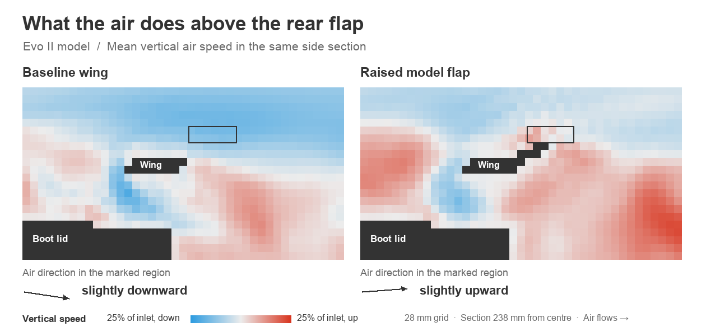

# Component wind tunnels for the 190 E Evo II and W 196 R

Remove the Evo’s **Road car on the autobahn** CFD step. Move its road-car comparison into the background. Give the racing car three close-ups, beginning with the rear wing, followed by the splitter and the front wheel arch. Give the W 196 R one close-up of the front wheel in its two body styles. In both stops the museum photo locates the part, and the next scroll takes the visitor straight to the airflow.

## What the visitor sees

| Part | View and action | What to watch |
| --- | --- | --- |
| **Evo rear wing** | Side view of the boot lid, wing and a short stretch of wake. Start at the baseline and tap **Raise flap**. Keep a faint outline of the previous flap position. | A short arrow at a fixed point above the trailing edge tips upward. Air leaving the wing carries more upward momentum. The existing whole-car calculation gives the track consequence in the details, about **34 kg more rear load and 9 kW more drag power at 200 km/h** in this model. |
| **Evo front splitter** | Side section at road level. Keep the bumper, lip and road in frame. Tap **Lip in / Lip forward**. Show the starting edge with a small tick so the travel is immediately visible. | Follow air meeting the upper face and air passing through the gap below. Use the same pressure scale for both settings. Show a pressure difference across the lip only if the local run resolves it. If the two settings have a weak flow difference, teach how one lip divides the air with two labelled paths. |
| **Evo front wheel arch** | Look down on the tyre shoulder and the outside edge of the flared arch. Begin with **Follow the air**. Show a narrow ribbon entering beside the tyre, then trace it past the flare into the air beside the door. | The sideways turn around the shoulder is visible in plan. A fixed cross-section just behind the tyre can show where the slower air ends up. Add **Flared / Reference arch** only if a slimmer contour clears the same tyre and produces a repeatable difference. The reference would be a design experiment. |
| **W 196 R front wheel** | Match the photo by starting **Enclosed**. Tap **Exposed**. In a wheel-height plan section the streamlined fairing gives way to the front tyre. Retain a small section of the inboard body as a landmark. | Follow the slow air downstream. At one fixed station in the air behind the wheel, outline the region below the same speed threshold in both cases. The visitor can point to where the wake moves or changes width. Let the computed result set the caption. Follow the comparison with the driver’s trade-off. The streamliner suited fast tracks. Exposed front wheels helped drivers place the car in corners. |

Mercedes-Benz describes a two-position longitudinal front spoiler and a retractable upper rear flap on the homologation Evo. The current raised-flap geometry is illustrative. Use the exhibit photo and period drawings to establish the final part shapes. For the W 196 R, frame the comparison as a front-corner view of two distinct racing bodies. [Mercedes-Benz on the Evo adjustments](https://media.mercedes-benz.com/en/article/4e61dcd8-fd75-47ca-830c-056734a165c2) · [Mercedes-Benz on the W 196 R bodies](https://media.mercedes-benz.com/en/article/b210a620-ecd7-42dc-b364-af3e85ff3d6c)

## What the current tooling can show

**The wing can be prototyped now.** The figure comes from the saved 3-D velocity fields. On the 28 mm grid, the mean air direction in the box changes from about 9° down to 4° up. On the 40 mm grid it changes from about 2° down to 6° up. The box samples the same physical volume on both grids, 3.75–3.92 m behind the front axle, 1.23–1.29 m high and 0.20–0.30 m from the centre line. The arrows show the direction of the mean velocity projected into the side view. Both grids support the direction of change. Their different angles favour a simple arrow in the exhibit. The underlying Evo II mesh is by marksform (CC BY-NC 4.0). [Source mesh](https://sketchfab.com/3d-models/mercedes-benz-evolution-ii-190e-983f5e165dee4e7c801a49c33f8e76f1) · [Case generator](../tools/cfd/geometry.mjs) · [Solver outputs](../tools/cfd/run.mjs)

**The splitter and arch need new geometry at finer resolution.** I compared the saved half-car solid masks cell by cell. At 28 mm, the flap changes 90 cells, the 40 mm lip extension changes 30, and the arch trim changes zero. At 40 mm the counts are 39, 26 and zero. Every exported force change for the lip falls below the project’s reporting criterion. The current renderer marks the part on the same car outline, paints two fixed slices and moves dots along saved mean-flow paths. Zoom can reveal information in those fields, but the arch cases are geometrically identical. [Evo geometry](../tools/cfd/geometry.mjs) · [Force comparison and slice export](../tools/cfd/export.mjs) · [Current renderer](../subsystems/race-aero.js)

**The W 196 R comparison misses the wheels.** Both settings produce the same 218 × 64 solid mask. The speed readout changes because the straight-line model uses different assumed drag, area and mass. The live tunnel has a moving road and a stationary body polygon in a vertical plane. It can show air passing above and below a splitter. It has no sideways velocity for flow around a wheel. [W 196 R data](../stops/w196r/car.js) · [Tunnel selection](../subsystems/aero.js) · [2-D flow solver](../lib/model/flow.js)

## How to compute the close-ups

1. **Wing first.** Re-export the local mask and velocity patch from the saved Evo volumes to try the interaction shown above. The published files contain only two fixed speed/pressure slices and pretraced paths. The full velocity fields and source mesh are present in this checkout and excluded from Git. For a dedicated local run, keep the boot and wing gap and sample the incoming flow from the original car run. Check the local result against the existing wing trend. Keep the whole-car force figures attributed to the original calculation. [3-D exporter](../tools/cfd/export.mjs) · [Local CFD inputs](../tools/cfd/.gitignore)
2. **Splitter next.** Run the existing 2-D solver offline on two fine nose sections with the same road, bumper and ride height. A 5 mm trial grid gives eight cells across the illustrative 40 mm extension and five across its 25 mm thickness. Refine it and move the domain boundaries to check the pressure pattern. Export each settled field so the visitor sees the new state on the first tap. The local section can support a statement about pressure on the lip. Front axle load requires forces and pitching moment over the car. [2-D solver](../lib/model/flow.js) · [Current lip dimensions](../tools/cfd/geometry.mjs)
3. **Use the offline 3-D solver for both front corners.** Build the tyre, real wheelhouse cavity, adjacent flank and moving road. Keep tyre size, placement and inlet conditions fixed within each comparison. Allow air to pass on both sides of the outer shoulder. The current Evo tool fills body columns to a simplified floor and puts a stationary cylinder one cell above the road. Its rotating-wall option produced artificial pumping on the stepped tyre. Before showing wheel spin, verify a resolved rotating tyre against a moving-ground wheel benchmark. A stationary-wheel comparison can demonstrate the effect of the bodywork if labelled and checked on those terms. Verify the inlet and lateral boundary placement for the cropped domain. The existing runner assumes uniform inflow and a mirror at the vehicle centre. [Voxel geometry](../tools/cfd/geometry.mjs) · [3-D solver boundaries](../tools/cfd/lbm3d.mjs) · [Experimental wheel and wheelhouse comparison](https://www.mdpi.com/1996-1073/12/17/3340)

For each new case, inspect the solid mask before solving. Record the local quantity the visitor will see, such as the face-to-face pressure difference or the wake width at a fixed downstream station. Check its direction on two grids and its variation over multiple settled time windows. The present 3-D runs operate far below the car’s full-scale Reynolds number. A component run can support a local observation. Whole-car drag, axle load and top speed need their own evidence. [Run conditions](../tools/cfd/run.mjs) · [Current force reporting](../tools/cfd/export.mjs)

## Phone interaction and acceptance

Use the existing pinned story with a separate camera target for each part. Show one close-up at a time in portrait. Put the prompt, two named positions where applicable, and one sentence describing the result beside the stage. Switch the solid outline and its computed field together. Hold camera, inlet speed, colour range and tracer seeds fixed across settings. Keep an outline, a direction arrow or a wake contour visible when paused. Put pressure/speed choices and modelling notes in the existing detail disclosure. The same control and takeaway should fit in Hungarian. [Story steps](../lib/app/story.js) · [Viewer cameras](../lib/app/viewer.js) · [Panel controls](../lib/app/panel.js)

Serve compact paired fields and paths from the stop folders so the existing service worker caches them. Check a cold offline opening after the tour reports ready. On an iPhone, pause, switch settings and ask a visitor to point to what changed in the air before opening the details. Repeat with reduced motion and on iPad. If they can find the moving bodywork but need a number or a legend to find the airflow change, revise the view or teach the single-state effect. The wing figure demonstrates a local signal. The splitter and both wheel comparisons still need their local runs and device checks. [Offline build](../tools/build.mjs)
